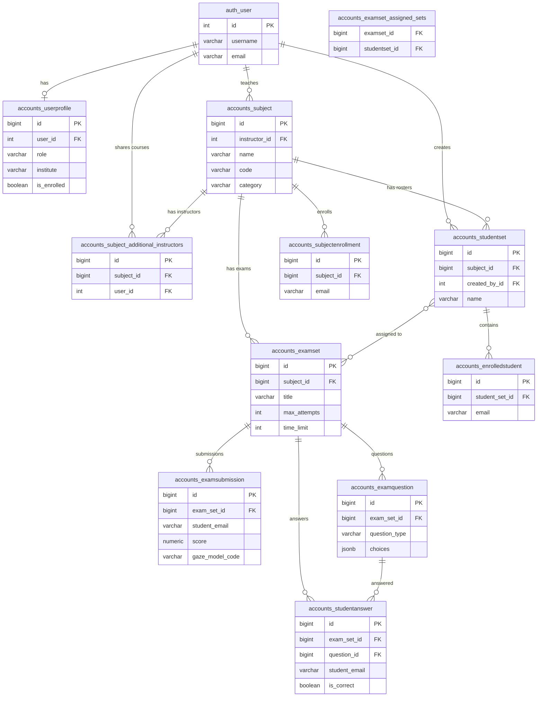

# Online Invigilator — Database ERD

**Database:** Supabase PostgreSQL (schema: `public`)

## How to export as PDF

### Option A — HTML (recommended)
1. Open `docs/database-erd.html` in Chrome or Edge.
2. Press `Ctrl+P` → **Save as PDF**.
3. Set orientation to **Landscape**.

### Option B — Markdown + Mermaid CLI
```bash
npx @mermaid-js/mermaid-cli -i docs/database-erd.mmd -o docs/database-erd.pdf
```

---

## Entity Relationship Diagram



## Table summary

| Table | Function |
|-------|----------|
| `auth_user` | Login accounts |
| `accounts_userprofile` | Role and profile data |
| `accounts_subject` | Courses |
| `accounts_studentset` | Student rosters |
| `accounts_enrolledstudent` | Emails in a roster |
| `accounts_subjectenrollment` | Emails enrolled in a course |
| `accounts_examset` | Exams/assignments |
| `accounts_examset_assigned_sets` | Exam ↔ roster assignment |
| `accounts_examsubmission` | Student exam attempts |
| `accounts_examquestion` | Exam questions |
| `accounts_studentanswer` | Student answers |
